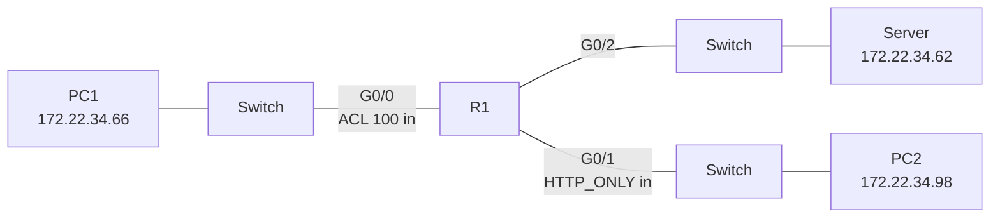

# Extended IPv4 ACLs — Packet Tracer Study Project

This NetAcad study project configures and verifies two extended IPv4 access control lists on router R1.

## Objective

- PC1 can use FTP and ICMP to reach the server.
- PC2 can use HTTP and ICMP to reach the server.
- PC1 and PC2 cannot exchange traffic.
- The original PKA is preserved beside the completed copy.

## Addressing plan

| Device | Interface | IPv4 address | Mask | Default gateway |
| --- | --- | --- | --- | --- |
| R1 | G0/0 | 172.22.34.65 | 255.255.255.224 | — |
| R1 | G0/1 | 172.22.34.97 | 255.255.255.240 | — |
| R1 | G0/2 | 172.22.34.1 | 255.255.255.192 | — |
| Server | NIC | 172.22.34.62 | 255.255.255.192 | 172.22.34.1 |
| PC1 | NIC | 172.22.34.66 | 255.255.255.224 | 172.22.34.65 |
| PC2 | NIC | 172.22.34.98 | 255.255.255.240 | 172.22.34.97 |

## Topology



## Configuration

### Numbered extended ACL

The ACL is applied inbound on `GigabitEthernet0/0`, the PC1 network interface.

```text
access-list 100 permit tcp 172.22.34.64 0.0.0.31 host 172.22.34.62 eq ftp
access-list 100 permit icmp 172.22.34.64 0.0.0.31 host 172.22.34.62
interface GigabitEthernet0/0
 ip access-group 100 in
```

### Named extended ACL

The ACL is applied inbound on `GigabitEthernet0/1`, the PC2 network interface.

```text
ip access-list extended HTTP_ONLY
 permit tcp 172.22.34.96 0.0.0.15 host 172.22.34.62 eq www
 permit icmp 172.22.34.96 0.0.0.15 host 172.22.34.62
interface GigabitEthernet0/1
 ip access-group HTTP_ONLY in
```

Each list has an implicit deny for traffic that does not match the two permit entries.

## Verification

The following checks were performed in Packet Tracer through the MCP bridge:

| Test | Result |
| --- | --- |
| PC1 ping to server | Allowed, 4/4 replies, 0% loss |
| PC1 FTP login to server | Allowed, `cisco` login accepted |
| PC1 ping to PC2 | Blocked, destination host unreachable |
| PC2 ping to server | Allowed, 4/4 replies, 0% loss |
| PC2 FTP to server | Blocked |
| PC2 ping to PC1 | Blocked, destination host unreachable |

`show access-lists` confirmed the required order and recorded these matches:

| ACL | Entry | Matches |
| --- | --- | ---: |
| 100 | FTP permit | 10 |
| 100 | ICMP permit | 12 |
| HTTP_ONLY | HTTP permit | 0 |
| HTTP_ONLY | ICMP permit | 12 |

The HTTP rule is configured with the required protocol, destination and port. Its counter remains at zero because the graphical Packet Tracer browser step was not opened through the bridge. Open PC2 Web Browser and request the server address to complete that visual check.

## Files

- `PedroFerreira_2026-10-21_Configurar-ACL-Estendida-base.pka` — preserved source PKA.
- `PedroFerreira_2026-10-21_Configurar-ACL-Estendida-concluido.pka` — configured and tested PKA.
- `PedroFerreira_2026-10-21_Configurar-ACL-Estendida-Relatorio.docx` — Portuguese execution report with the addressing table, commands and evidence.

Completed PKA SHA-256:

```text
8FB046B0A8C52879D1EF8F5ACE23E55820E3C0BC6E4BB9FD7CE24AAB5F5D40E2
```

This folder contains study material from NetAcad and is separate from production network documentation.
