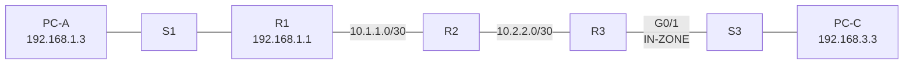

# Configure a ZPF — Packet Tracer Study Project

This NetAcad study project configures a zone based policy firewall on R3 and verifies traffic between the internal and external networks.

## Objective

- Allow PC-C on the internal network to initiate traffic toward external resources.
- Block new connections initiated from the external network toward PC-C.
- Verify the result with ICMP, SSH and HTTP checks.

## Addressing

| Device | Interface | IPv4 address | Mask | Gateway |
| --- | --- | --- | --- | --- |
| R1 | G0/1 | 192.168.1.1 | 255.255.255.0 | — |
| R1 | S0/0/0 (DCE) | 10.1.1.1 | 255.255.255.252 | — |
| R2 | S0/0/0 | 10.1.1.2 | 255.255.255.252 | — |
| R2 | S0/0/1 (DCE) | 10.2.2.2 | 255.255.255.252 | — |
| R3 | G0/1 | 192.168.3.1 | 255.255.255.0 | — |
| R3 | S0/0/1 | 10.2.2.1 | 255.255.255.252 | — |
| PC-A | NIC | 192.168.1.3 | 255.255.255.0 | 192.168.1.1 |
| PC-C | NIC | 192.168.3.3 | 255.255.255.0 | 192.168.3.1 |

## Topology



## R3 configuration

```text
zone security IN-ZONE
zone security OUT-ZONE
access-list 101 permit ip 192.168.3.0 0.0.0.255 any
class-map type inspect match-all IN-NET-CLASS-MAP
 match access-group 101
policy-map type inspect IN-2-OUT-PMAP
 class type inspect IN-NET-CLASS-MAP
  inspect
zone-pair security IN-2-OUT-ZPAIR source IN-ZONE destination OUT-ZONE
 service-policy type inspect IN-2-OUT-PMAP
interface GigabitEthernet0/1
 zone-member security IN-ZONE
interface Serial0/0/1
 zone-member security OUT-ZONE
```

The policy uses `inspect` for traffic that matches ACL 101. The default class drops traffic that does not match the internal source network. Return traffic for inspected sessions is allowed by the stateful policy.

## Verification evidence

The checks below were repeated live through the packet-tracer-mcp bridge on 2026-10-23, against `PedroFerreira_2026-10-23_Configurar-ZPF-concluido.pkt.pka`.

`show running-config` confirmed `license boot module c1900 technology-package securityk9`, which the ZPF commands require.

`show zone security` confirmed G0/1 in `IN-ZONE` and S0/0/1 in `OUT-ZONE`.

`show zone-pair security` confirmed `IN-2-OUT-ZPAIR` uses `IN-2-OUT-PMAP`.

`show access-lists` confirmed ACL 101 permits `192.168.3.0/24` to any destination.

| Test | Result |
| --- | --- |
| PC-C ping to PC-A | Allowed, 3/4 replies live; the one loss was ARP resolution |
| PC-A ping to PC-C | Blocked, 0/4 replies live |
| R2 ping to PC-C | Blocked by the external to internal direction |
| PC-C SSH to R2 | Allowed; login as `Admin` reached the `R2#` prompt |
| PC-C HTTP to PC-A | Not tested; the bridge cannot open the PC's graphical browser |

With the SSH session open, R3 showed the inspected session:

```text
R3#show policy-map type inspect zone-pair sessions
 Zone-pair: IN-2-OUT-ZPAIR
  Service-policy inspect : IN-2-OUT-PMAP
    Class-map: IN-NET-CLASS-MAP (match-all)
      Match: access-group 101
      Inspect
        Number of Established Sessions = 1
         Session 847820912 (192.168.3.3:1025)=>(10.2.2.2:22) tcp SIS_OPEN/TCP_ESTAB
    Class-map: class-default (match-any)
      Match: any
      Drop (default action)
```

The SSH session was closed after the test.

Check Results: 100%, confirmed in the Packet Tracer activity window. The activity file is password protected, so the bridge cannot read the score itself.

The first ping can lose one packet while ARP resolves. Repeat the test before judging the policy.

## Files

- `PedroFerreira_2026-10-23_Configurar-ZPF-base.pka` — preserved source PKA.
- `PedroFerreira_2026-10-23_Configurar-ZPF-concluido.pka` — configured PKA.
- `PedroFerreira_2026-10-23_Configurar-ZPF-Relatorio.docx` — Portuguese execution report.

- `PedroFerreira_2026-10-23_Configurar-ZPF-concluido.pkt.pka` — later save, used for the live verification.

Completed PKA SHA-256:

```text
33D97F1390414D2F2779EC4EB4FFFD3C610A73DB6736292F1FAD16536B955AE0  ...-concluido.pka
EF33EB48185C999D56C9F1F29BC9E373AAF09B58A9604768D98BD9ED6D4424A2  ...-concluido.pkt.pka
```

This is an academic NetAcad study project. It is kept in the study archive and does not represent a production firewall policy.
