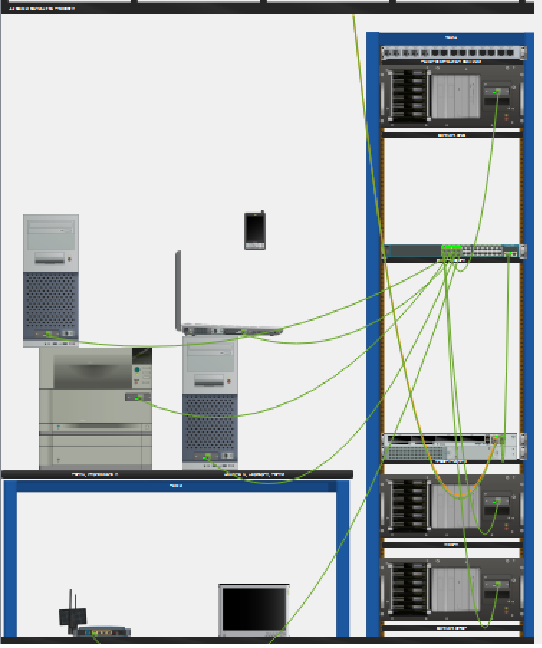
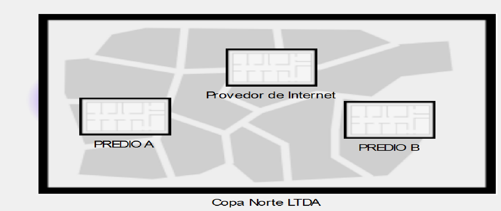

# NetAcad Study Archive

This folder contains the original Packet Tracer activities and reference files collected during the SENAC RJ Cisco Cybersecurity course.

## Inventory

There are 47 original study or reference files in this folder, plus this README:

- 32 `.pka` guided activities.
- 3 `.pksz` packaged activities.
- 4 `.pkt` saved topologies.
- 1 `.zip` archive.
- 5 `.png` diagrams and Physical views.
- 1 `.htm` activity reference.
- 1 `.txt` configuration record.

The archive is about 347 MiB. The largest file is below the GitHub single-file limit. Filenames and formats remain unchanged.

## Visual files

## Suggested study order

1. Open a simple network activity.
2. Record the device names, interfaces, and address table.
3. Complete the guided configuration.
4. Check the result inside Packet Tracer.
5. Repeat the same idea in a saved `.pkt` file.
6. Compare the result with `PedroFerreira-configuracoes.txt` when the topic is routing, services, or wireless.

## ACL activities — configured and documented

Six ACL activities were completed and the full IOS command sets are recorded in [`acl-configs.md`](acl-configs.md).

| Activity file | ACL type | What it does |
|---|---|---|
| `Configurar ACLs IPv4 padrão numeradas.pka` | Standard numbered | ACL 1 blocks a host on S0/0/0 out; ACL 2 restricts VTY access |
| `Configuração de ACLs IPv4 nomeadas padrão.pka` | Standard named | `PERMIT_HOST` and `DENY_HOST` on R1 |
| `configurar o cenário de ACLs estendidas 1.pka` | Extended numbered + named | ACL 100 (FTP + ICMP) and `HTTP_ONLY` applied inbound on R1 |
| `Configurar Cenário de ACLs estendidas 2.pka` | Extended named | `ACL` blocks HTTP/HTTPS/FTP/ICMP per host on RT1 |
| `Configurar ACLs IPv6.pka` | IPv6 | `BLOCK_HTTP` on R1 Gi0/1 in; `BLOCK_ICMP` on R3 Gi0/0 out |
| `packet-tracer-configure-ip-acls-to-mitigate-attacks.pksz` | IPv4 multi-ACL | ACLs 10, 100, 110, 120 across R1/R2/R3 — anti-spoofing, service filtering, VTY restriction |
| `packet-tracer-configure-a-zpf.pksz` | Zone-Based Policy Firewall | ZPF em R3: IN-ZONE (G0/1) → OUT-ZONE (S0/0/1), inspeciona TCP/UDP/ICMP, bloqueia tráfego externo entrante |

The `.pka` files are not committed (binary format); the `.pksz` is a sealed assessment container. `acl-configs.md` is the durable record.

## Cryptography lab — completed on Kali Linux CLI

The JCrypTool lab "Use algoritmos de criptografia clássica e moderna" was replicated on Kali Linux using `openssl` and `python3` instead of the CSE-LABVM GUI.

| Part | Algorithm | Tool | Notes |
|---|---|---|---|
| 1 | Caesar cipher (shift=10, key K) | `python3` | Classical substitution cipher; also ROT13 (shift=13) |
| 2 | AES-128-ECB | `openssl enc` | Key `AA 00…00 FF`; ECB mode for lab parity |
| 3 | RSA-1024 | `openssl genrsa` + `pkeyutl` | Key pair equivalent to JCrypTool "John Smith" entry |

Full documentation: [`PedroFerreira_2026-10-28_Lab-Criptografia-Classica-Moderna-README.md`](PedroFerreira_2026-10-28_Lab-Criptografia-Classica-Moderna-README.md)  
Bash script: [`PedroFerreira_2026-10-28_lab-criptografia.sh`](PedroFerreira_2026-10-28_lab-criptografia.sh)

## Topics represented

- LAN construction and Packet Tracer navigation.
- IPv4 addressing, MAC identification, `ipconfig`, and ping.
- DHCP, DNS, Web, FTP, and NAT.
- Wireless router setup, client association, and wireless troubleshooting.
- ACLs, data integrity, threat scenarios, and physical IoT security.

## Local source

`D:\VSCODE_PROJECTS\SENAC_CISCO_CIBERSECURITY\Packet Tracer\NetAcad`

## Git branch

The collection is published in [`projeto-netacad-estudos`](https://github.com/DATAdotPDF/SENAC-CISCO/tree/projeto-netacad-estudos). It is marked as study material and is separate from the delivery branches.

## Study boundary

Do not treat the activities as production configurations. Keep credentials private. Make a working copy before changing an original guided activity.
