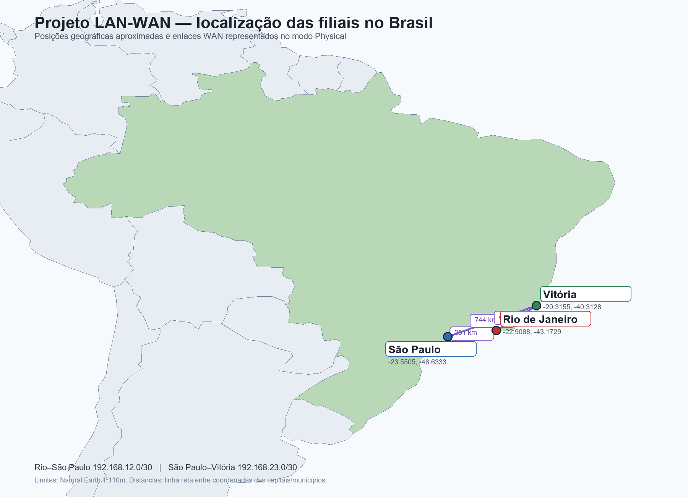
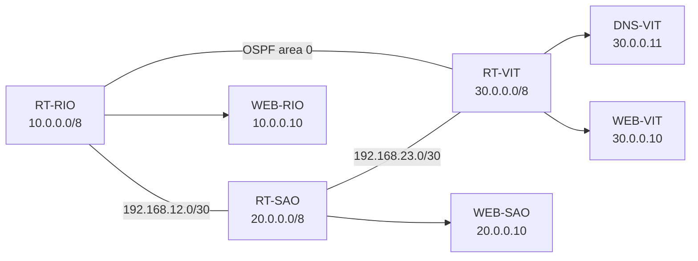

# LAN-WAN and Security Project

This branch documents a three-office Cisco Packet Tracer network for the SENAC RJ Cisco Cybersecurity course. The offices are Rio de Janeiro, São Paulo, and Vitória. The logical network uses routed serial links. The Physical view places each office in its Brazilian city, with one building and one technical closet per branch.

## What this project demonstrates

- Serial WAN between three routers.
- OSPF area 0 with full serial neighbors.
- LAN blocks `10.0.0.0/8`, `20.0.0.0/8`, and `30.0.0.0/8`.
- DHCP pools for the three branches and the Vitória departments.
- Central DNS in Vitória at `30.0.0.11`.
- Web servers `WEB-RIO`, `WEB-SAO`, and `WEB-VIT`.
- DNS names `rio.com`, `sao.com`, and `vitoria.com`.
- WEP on the three access points, with the three laptops associated and receiving DHCP.
- VLANs for the Vitória Factory, IT, and Management departments.
- SSH version 2, RSA 2048-bit keys, management ACL, port security, and inter-branch ACLs.
- A documented design for scaling the address plan without adding 390 individual devices to the file.

## Visual map



The Physical layout uses Rio de Janeiro, São Paulo, and Vitória. The image is also useful when reviewing the distance and location rationale outside Packet Tracer.



## Addressing plan

| Office | LAN | Gateway | Web server | DNS name |
|---|---|---:|---:|---|
| Rio de Janeiro | `10.0.0.0/8` | `10.0.0.1` | `10.0.0.10` | `rio.com` |
| São Paulo | `20.0.0.0/8` | `20.0.0.1` | `20.0.0.10` | `sao.com` |
| Vitória | `30.0.0.0/8` | `30.0.0.1` | `30.0.0.10` | `vitoria.com` |

| Serial link | Addresses |
|---|---|
| Rio–São Paulo | `192.168.12.1/30` and `192.168.12.2/30` |
| São Paulo–Vitória | `192.168.23.1/30` and `192.168.23.2/30` |
| DNS-VIT | `30.0.0.11/8` |

DHCP pools exclude `.1` through `.99`. The pool supplies the branch gateway and the Vitória DNS address.

## Vitória VLAN plan

| VLAN | Department | Subnet | Gateway |
|---:|---|---|---|
| 30 | Branch LAN | `30.0.0.0/16` | `30.0.0.1` |
| 31 | Factory | `30.31.0.0/16` | `30.31.0.1` |
| 32 | IT | `30.32.0.0/16` | `30.32.0.1` |
| 33 | Management | `30.33.0.0/16` | `30.33.0.1` |
| 99 | Guest and third parties | reserved | no production clients |

The uplink uses an 802.1Q trunk. Factory, IT, and Management have separate access ports. VLAN 99 is reserved for future guest use.

## Configuration procedure

1. Build `RT-RIO`, `RT-SAO`, `RT-VIT`, the three switches, servers, APs, and representative clients.
2. Assign the LAN and serial addresses from the tables above. Bring every interface up.
3. Enable OSPF area 0 and advertise the LAN and serial networks. Check that the serial neighbors reach `FULL`.
4. Configure DHCP pools. Reserve infrastructure addresses before enabling clients.
5. Configure DNS-VIT and add the A records for `rio.com`, `sao.com`, and `vitoria.com`.
6. Enable HTTP on the three Web servers and verify each page by IP and by DNS name.
7. Create the Vitória VLANs, assign access ports, and configure the uplink trunk.
8. Configure WEP on each AP and associate `LAP-RIO`, `LAP-SAO`, and `LAP-VIT`. Verify DHCP on each laptop.
9. Configure port security with sticky MAC addresses and the `restrict` action on the selected access ports.
10. Generate RSA 2048-bit keys, enable SSH version 2, create local login, and apply `MGMT-SSH` to the VTY lines.
11. Apply ACL 100 on the São Paulo edge to block Rio-to-São Paulo traffic. Apply `VIT-FABRICA-ONLY` inbound on the Factory subinterface.
12. Save the running configuration, save the `.pkt`, reopen it, and repeat the tests.

Useful verification commands:

```text
show ip ospf neighbor
show ip route
show ip dhcp binding
show vlan brief
show interfaces trunk
show port-security
show access-lists
show ip ssh
show running-config | section line vty
```

## Security controls

### Management access

`MGMT-SSH` permits the Vitória IT subnet `30.32.0.0/16` and denies other origins. PC-TI authenticated with SSH. PC-RH was refused.

### Inter-branch ACL

ACL 100 on `RT-SAO Gi0/0` outbound blocks `10.0.0.0/8` toward the São Paulo network and permits the other traffic required by the scenario.

### Factory ACL

`VIT-FABRICA-ONLY` allows the Factory network to reach its gateway, DHCP, DNS, ICMP, and the three Web servers. It blocks access to the IT network.

### Wireless and access ports

WEP is kept because it is an explicit academic requirement. Port security protects the selected PC ports with one sticky MAC per port. WEP and port security are laboratory controls, not a recommendation for a new production network.

## Final verification

| Source | Destination | Result |
|---|---|---|
| PC-RH | DNS-VIT `30.0.0.11` | 4/4 replies |
| PC-VEN | WEB-RIO `10.0.0.10` | 4/4 replies |
| PC-TI | WEB-SAO `20.0.0.10` | 4/4 replies |
| PC-TI | WEB-RIO `10.0.0.10` | 4/4 replies |
| PC-FAB | Factory gateway `30.31.0.1` | 4/4 replies |
| PC-ADM | WEB-RIO `10.0.0.10` | 4/4 replies |
| PC-EST | São Paulo gateway `20.0.0.1` | 4/4 replies |
| PC-MKT | WEB-VIT `30.0.0.10` | 4/4 replies |
| PC-DIR | Management gateway `30.33.0.1` | 4/4 replies |

The final evidence records 36 replies from 36 requests. The first ping after a change can lose packets while ARP resolves. An incomplete tool response with `sent=0` is not treated as a complete failed test.

HTTP was opened by name from the clients. The WEP laptops received DHCP. OSPF neighbors returned to `FULL` after reopening the saved file. ACL counters were checked with `show access-lists`.

## Scalability note

The file contains representative PCs, servers, switches, routers, and APs. It does not draw 390 individual clients. The `/8` office blocks, department subnets, DHCP ranges, gateways, VLANs, and OSPF advertisements show how the design can be expanded with more access switches and ports while keeping the same routing model.

## Files

- [Packet Tracer project](packet-tracer/Projeto-LAN-WAN/PedroFerreira_2026-10-13_Projeto-LAN-WAN.pkt)
- [Portuguese report](packet-tracer/Projeto-LAN-WAN/PedroFerreira_2026-10-13_Relatorio-Projeto-LAN-WAN-revisado.docx)
- [Detailed project README](packet-tracer/Projeto-LAN-WAN/README-Projeto-LAN-WAN-revisado.md)
- [Test evidence](packet-tracer/Projeto-LAN-WAN/Evidencias-Projeto-LAN-WAN-atualizadas.json)
- [Assignment document](documentos/Projeto de LAN-WAN.docx)

## Known limits

The project is a controlled Packet Tracer simulation. WEP remains only because the assignment asks for it. Guest VLAN 99 has no connected clients. The Physical view was arranged manually and the branch map is included as evidence. Salvador is not part of this assignment, which names Rio de Janeiro, São Paulo, and Vitória.

## Author

Pedro Dutra Ferreira

Cisco Cybersecurity Course

Senac RJ
