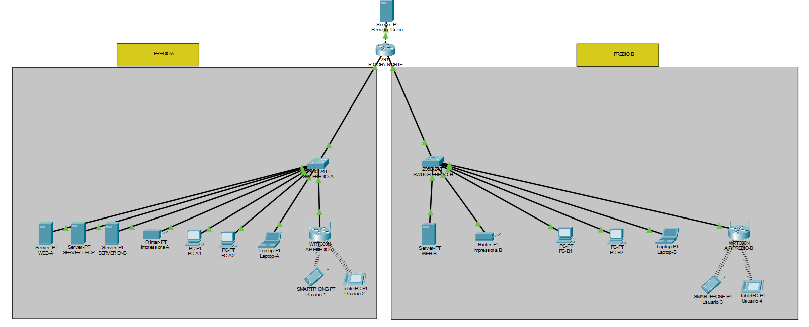
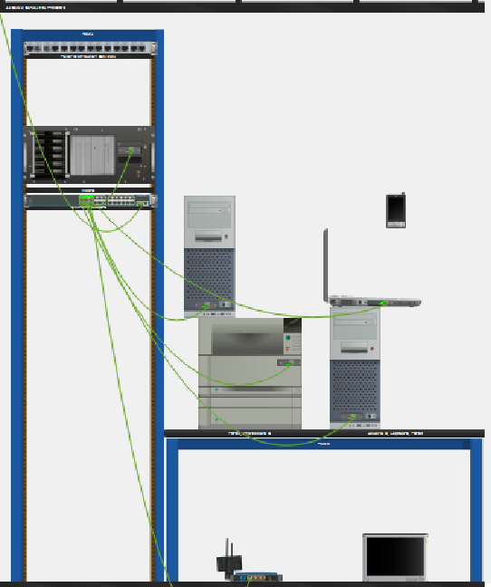
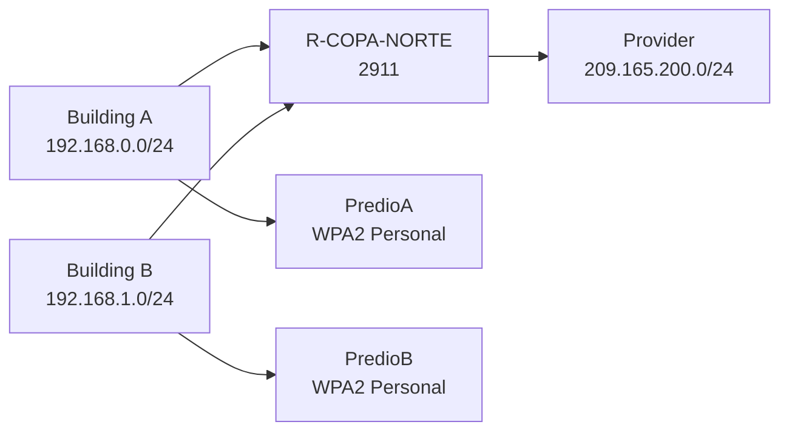

# Copa Norte LTDA Network Project

This branch documents a Cisco Packet Tracer study project for a company called Copa Norte LTDA. The design separates two buildings, supplies wired and wireless users, publishes internal Web services, and simulates an external provider through NAT/PAT.

## Project goals

- Connect Building A and Building B through one Cisco 2911 router.
- Use DHCP in Building A and static addressing in Building B.
- Provide DNS, Web, printer, and file access paths needed by the scenario.
- Connect four mobile devices through protected Wi-Fi.
- Publish `site.com`, `vendas.com`, and `cisco.com`.
- Test access from the internal networks to the simulated Internet.
- Record the logical and Physical layouts so another student can reproduce the lab.

## Visual evidence

### Logical topology



### Physical topology


### Building and provider views

| Building A | Building B | Provider |
|---|---|---|
|  |  |  |



## Addressing plan

| Segment | Addressing | Gateway |
|---|---|---|
| Building A | `192.168.0.0/24` | `192.168.0.1` |
| Building B | `192.168.1.0/24` | `192.168.1.1` |
| Simulated Internet | `209.165.200.0/24` | `209.165.200.1` |

| Device or service | Address |
|---|---:|
| AP-PREDIO-A | `192.168.0.2` |
| SW-PREDIO-A | `192.168.0.3` |
| SRV-DHCP | `192.168.0.10` |
| SRV-DNS | `192.168.0.11` |
| SRV-WEB-A | `192.168.0.20` |
| IMPRESSORA-A | `192.168.0.30` |
| AP-PREDIO-B | `192.168.1.2` |
| SW-PREDIO-B | `192.168.1.3` |
| SRV-WEB-B | `192.168.1.20` |
| IMPRESSORA-B | `192.168.1.30` |
| SRV-CISCO | `209.165.200.10` |

Building A PCs and its laptop receive DHCP addresses from the pool that starts at `192.168.0.100`. Building B clients use the static addresses recorded in the branch report.

## Equipment

- One Cisco 2911 router: `R-COPA-NORTE`.
- Two Cisco 2960-24TT switches.
- Two WRT300N devices used as access points.
- Five servers for DHCP, DNS, Web, and the external provider.
- Four PCs, two laptops, four mobile devices, and two printers.

## Configuration procedure

1. Add the router, two switches, access points, servers, clients, mobile devices, and printers.
2. Connect Building A to G0/0, Building B to G0/1, and the provider network to G0/2.
3. Assign the gateway and management addresses from the table.
4. Configure the Building A DHCP server and check that PCs and the laptop obtain an address, gateway, and DNS server.
5. Configure static addresses in Building B.
6. Configure DNS records for `site.com`, `www.site.com`, `vendas.com`, `www.vendas.com`, `cisco.com`, and `www.cisco.com`.
7. Enable HTTP and HTTPS on Web Server A, Web Server B, and the provider Web server.
8. Configure `PredioA` and `PredioB` with WPA2 Personal and AES. Disable the access point DHCP services so the central plan remains authoritative.
9. Configure the two printers and check their gateway reachability.
10. Mark G0/0 and G0/1 as inside for NAT. Mark G0/2 as outside.
11. Use an ACL for `192.168.0.0/24` and `192.168.1.0/24`, then apply PAT overload on the external interface.
12. Save the `.pkt`, export the logical and Physical images, and repeat the tests from clean client sessions.

## Verification checklist

| Test | Expected result |
|---|---|
| Building A client receives DHCP | Address, gateway, and DNS are assigned |
| Building B client uses static addressing | Gateway and DNS are reachable |
| Client reaches both internal networks | ICMP replies return after ARP resolution |
| `site.com` resolves | Building A Web server opens |
| `vendas.com` resolves | Building B Web server opens |
| `cisco.com` resolves | Simulated provider page opens |
| Mobile devices associate | `PredioA` or `PredioB` accepts the WPA2 credentials |
| Printers respond | Each building printer answers through its gateway |
| NAT/PAT translates an external request | `show ip nat translations` shows the session |

Useful router checks:

```text
show ip interface brief
show ip route
show ip dhcp binding
show ip nat translations
show access-lists
```

## Files in this branch

- [Packet Tracer project](packet-tracer/PedroFerreira-prjrede.pkt)
- [Configuration notes](configuracoes/PedroFerreira-configuracoes.txt)
- [Logical topology](imagens/PedroFerreira-topologia-logica.png)
- [Physical topology](imagens/PedroFerreira-topologia-fisica.png)
- [Building A view](imagens/PedroFerreira-fisica-predio-A.png)
- [Building B view](imagens/PedroFerreira-fisica-predio-B.png)
- [Provider view](imagens/PedroFerreira-fisica-provedor.png)

## Study limits

This is a controlled academic simulation. The access keys are intentionally not published. The provider is simulated inside Packet Tracer. The number of visible clients is a test sample, not a claim that a production network would run on only these devices.

## Author

Pedro Dutra Ferreira

Cisco Cybersecurity Course

Senac RJ
