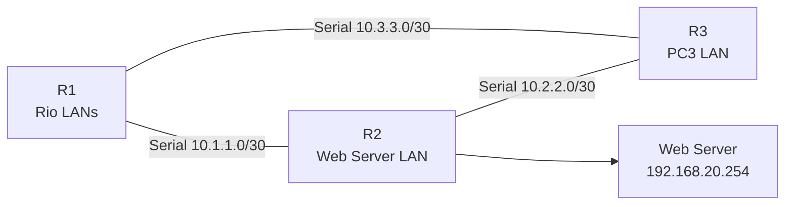
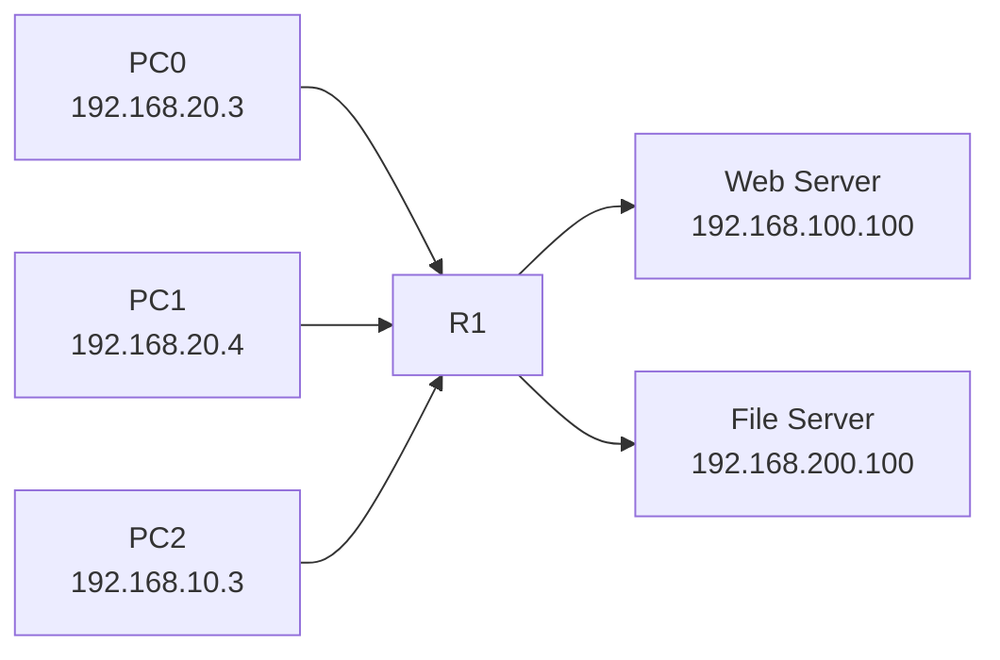

# Cisco Packet Tracer ACL Study Project

This branch records the ACL work from the SENAC RJ Cisco Cybersecurity course. It keeps two activity versions separate because the supplied materials describe different topologies and different ACL tasks.

## Start here

| Version | Source | Purpose |
|---|---|---|
| Three-router version | `Portuguese_4_5_6_Packet_Tracer_Configure_Numbered_Standard_IPv4_ACLs.docx` | Follow the written activity with R1, R2, R3, serial links, EIGRP, and ACLs on R2 and R3. |
| One-router named version | `Portuguese_Configure_Named_Standard_IPv4_ACLs_pka.pka` | Follow the PKA scenario with R1, four switches, PC0, PC1, PC2, Web Server, File Server, and a named ACL on R1. |

The two versions are study evidence for different instructions. They must not be evaluated as one incomplete topology.

## Visual comparison

### Three-router EIGRP activity



### One-router named ACL activity



## Three-router version

### Addressing

| Device | Interface or host | Address |
|---|---|---:|
| R1 | G0/0 | `192.168.10.1/24` |
| R1 | G0/1 | `192.168.11.1/24` |
| R1 | serial links | `10.1.1.1/30`, `10.3.3.1/30` |
| R2 | G0/0 | `192.168.20.1/24` |
| R2 | serial links | `10.1.1.2/30`, `10.2.2.1/30` |
| R3 | G0/0 | `192.168.30.1/24` |
| R3 | serial links | `10.3.3.2/30`, `10.2.2.2/30` |
| PC1 | workstation | `192.168.10.10/24` |
| PC2 | workstation | `192.168.11.10/24` |
| PC3 | workstation | `192.168.30.10/24` |
| Web Server | server | `192.168.20.254/24` |

### Procedure

1. Build R1, R2, R3, the LAN switches, the Web Server, and the serial links.
2. Assign the LAN and serial addresses from the table.
3. Enable EIGRP process 1 and advertise every LAN and serial network.
4. Check the EIGRP neighbors and routes before applying ACLs.
5. On R2, deny the PC2 source network toward the Web Server LAN, then permit the remaining sources.
6. On R3, deny the PC1 source network toward the PC3 LAN, then permit the remaining sources.
7. Apply each ACL outbound on the destination LAN interface.
8. Save the configuration and verify the counters with `show access-lists`.

Example numbered ACL pattern:

```text
access-list 1 deny 192.168.11.0 0.0.0.255
access-list 1 permit any
interface GigabitEthernet0/0
 ip access-group 1 out
```

### Expected results

| Source | Destination | Result |
|---|---|---|
| PC1 | PC2 | Permitted |
| PC1 | Web Server | Permitted |
| PC2 | Web Server | Denied |
| PC1 | PC3 | Denied |
| PC2 | PC3 | Permitted |
| PC3 | Web Server | Permitted |

## One-router named ACL version

### Addressing

- R1 F0/0: `192.168.10.1/24`
- R1 F0/1: `192.168.20.1/24`
- R1 E0/0/0: `192.168.100.1/24`
- R1 E0/1/0: `192.168.200.1/24`
- File Server: `192.168.200.100`, gateway `192.168.200.1`
- Web Server: `192.168.100.100`, gateway `192.168.100.1`
- PC0: `192.168.20.3`, gateway `192.168.20.1`
- PC1: `192.168.20.4`, gateway `192.168.20.1`
- PC2: `192.168.10.3`, gateway `192.168.10.1`

### Procedure

1. Test all PC-to-Web Server and PC-to-File Server paths before the ACL.
2. Open the R1 configuration window.
3. Create the named standard ACL with the exact name and order:

```text
ip access-list standard File_Server_Restrictions
 permit host 192.168.20.4
 permit host 192.168.100.100
 deny any
```

4. Apply it outbound on `FastEthernet0/1`:

```text
interface FastEthernet0/1
 ip access-group File_Server_Restrictions out
```

5. Save the configuration.
6. Check the ACL content and interface direction:

```text
show access-lists
show running-config
show ip interface fastethernet 0/1
```

7. Repeat the ping tests and read the match counters.

### Expected results

| Source | Web Server | File Server |
|---|---|---|
| PC0 | Permitted | Denied |
| PC1 | Permitted | Permitted |
| PC2 | Permitted | Denied |
| Web Server | — | Permitted |

The final named ACL counters recorded four matches for each permit line and eight matches for `deny any`.

## Files and evidence

- [Branch project README for the numbered activity](packet-tracer/Controle-de-Acesso-ACL/README-Projeto-ACL.md)
- [Named ACL README](packet-tracer/Controle-de-Acesso-ACL/README-Projeto-ACL-Nomeada.md)
- [Three-router Packet Tracer file](packet-tracer/Controle-de-Acesso-ACL/PedroFerreira_2026-10-21_Projeto-ACL-3-Roteadores.pkt)
- [One-router visual comparison](packet-tracer/Controle-de-Acesso-ACL/PedroFerreira_2026-10-21_Projeto-ACL-Literal-Visual.pkt)
- [Named ACL Packet Tracer file](packet-tracer/Controle-de-Acesso-ACL/PedroFerreira_2026-10-21_Projeto-ACL-Nomeada.pkt)
- [Three-router report](packet-tracer/Controle-de-Acesso-ACL/PedroFerreira_2026-10-21_Relatorio-Projeto-ACL-3-Roteadores.docx)
- [Named ACL report](packet-tracer/Controle-de-Acesso-ACL/PedroFerreira_2026-10-21_Relatorio-Projeto-ACL-Nomeada.docx)
- [Numbered ACL source document](documentos/Portuguese_4_5_6_Packet_Tracer_Configure_Numbered_Standard_IPv4_ACLs.docx)
- [Named ACL source activity](documentos/Portuguese_Configure_Named_Standard_IPv4_ACLs_pka.pka)

## Study limits

The branch documents Packet Tracer exercises, not a production firewall policy. Standard ACLs match source addresses only. The order of statements matters. A test result is accepted only after the expected path and the ACL counter are both checked.

## Author

Pedro Dutra Ferreira

Cisco Cybersecurity Course

Senac RJ
