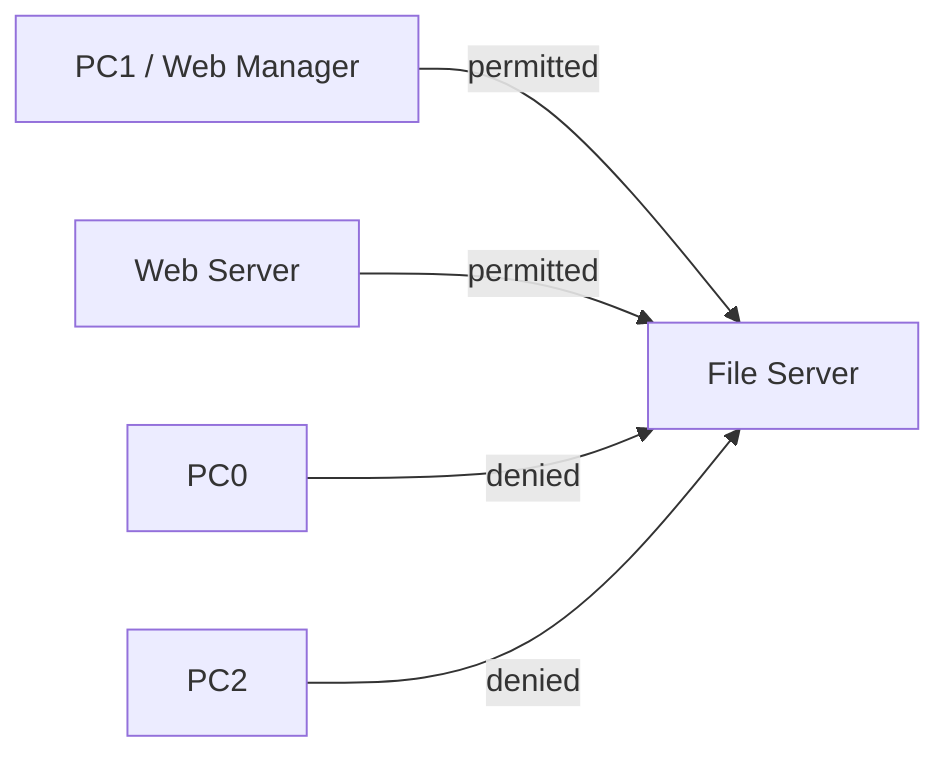

# SENAC-CISCO Cybersecurity Course

This repository records my study projects from the SENAC RJ Cisco Cybersecurity course. Each branch keeps one project or one study collection with its own files, evidence, procedure, and limitations.

## Start here

| Branch | Project | What you can inspect first |
|---|---|---|
| [`projeto-lan-wan`](https://github.com/DATAdotPDF/SENAC-CISCO/tree/projeto-lan-wan) | LAN-WAN and security | Three offices, serial WAN, OSPF, DHCP, DNS, WEP, VLANs, SSH, port security, and ACLs. |
| [`projeto-copa-norte`](https://github.com/DATAdotPDF/SENAC-CISCO/tree/projeto-copa-norte) | Copa Norte LTDA | Two buildings, wired and wireless clients, DHCP, DNS, Web, WPA2, NAT/PAT, and simulated Internet. |
| [`projeto-acl`](https://github.com/DATAdotPDF/SENAC-CISCO/tree/projeto-acl) | ACL studies | Numbered and named standard IPv4 ACL exercises, including the three-router activity and the one-router comparison. |
| [`projeto-netacad-estudos`](https://github.com/DATAdotPDF/SENAC-CISCO/tree/projeto-netacad-estudos) | NetAcad studies | 47 Packet Tracer activities and reference files collected during the course. |

Open the branch README before opening a `.pkt`, `.pka`, or `.pksz` file. The branch README explains the topology, addressing, configuration order, verification commands, evidence, and limits.

## Visual overview

### LAN-WAN offices


The LAN-WAN project places Rio de Janeiro, São Paulo, and Vitória in separate physical locations and connects their routers with serial links.

### Copa Norte buildings


The Copa Norte project separates Building A, Building B, and the simulated provider network.

### ACL traffic policy



The ACL branches document the rule order and the test results that prove each permitted or denied path.

## How the projects were produced

1. Read the assignment and separate its requirements from optional design choices.
2. Draw the logical topology and define the addressing table before configuring devices.
3. Build the devices and links in Cisco Packet Tracer.
4. Configure interfaces, routing, DHCP, DNS, Web, wireless access, and security controls in a repeatable order.
5. Test the expected paths with ICMP, DNS, HTTP, SSH, wireless association, and ACL counters.
6. Save the Packet Tracer file, reports, screenshots or maps, and command evidence.
7. Record limits such as simulated client counts, first-ping ARP delay, or differences between the written assignment and the supplied activity file.

## What each branch teaches

### LAN-WAN and security

The branch demonstrates a three-office routed network. It records OSPF area 0, serial addressing, DHCP and DNS services, Web servers, WEP association, department VLANs, SSH management, port security, and inter-network ACLs. The physical map uses the Brazilian locations as part of the explanation.

### Copa Norte LTDA

The branch demonstrates a small corporate network with two buildings. Building A uses DHCP. Building B uses static addressing. The project adds WPA2 Personal with AES, printers, DNS names, Web servers, NAT/PAT, and a simulated external provider.

### ACL studies

The branch keeps two activity interpretations separate. The three-router EIGRP version follows the numbered ACL DOCX. The one-router version follows the visual named ACL activity. The branch README explains why the topologies cannot be evaluated as the same scenario.

### NetAcad studies

The branch is an academic archive. It preserves the original activity filenames and formats so the exercises can be reopened in Packet Tracer. It is study material, not a production deployment.

## Repository structure

```text
README.md                         central course guide
packet-tracer/README.md           Packet Tracer project index
documentos/                       course requirements and written work
branches:
  projeto-lan-wan                LAN-WAN project
  projeto-copa-norte             Copa Norte project
  projeto-acl                    ACL project and comparison
  projeto-netacad-estudos        NetAcad study archive
```

## File and branch conventions

- Branch names identify the project or study collection.
- Packet Tracer files keep the original course or delivery filename.
- Reports and evidence stay beside the project file they explain.
- Wi-Fi passwords and private tokens are not published.
- A study activity is marked as study material when it is not a production deployment.

## Course scope

These files are controlled simulations for study and assessment. The number of visible PCs does not equal the planned number of users. DHCP pools, address blocks, routing, and port planning are used to explain how a design can scale without adding every client to the file.

## Author

Pedro Dutra Ferreira

Cisco Cybersecurity Course

Senac RJ
