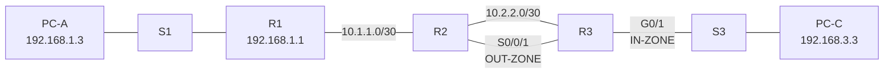

# Configure a ZPF — Packet Tracer Study Project

This NetAcad study project configures a zone based policy firewall on R3 and verifies traffic between the internal and external networks.

## Objective

- Allow PC-C on the internal network to initiate traffic toward external resources.
- Block new connections initiated from the external network toward PC-C.
- Verify the result with ICMP, SSH and HTTP checks.

## Addressing

| Device | Interface | IPv4 address | Mask | Gateway |
| --- | --- | --- | --- | --- |
| R1 | G0/1 | 192.168.1.1 | 255.255.255.0 | — |
| R1 | S0/0/0 (DCE) | 10.1.1.1 | 255.255.255.252 | — |
| R2 | S0/0/0 | 10.1.1.2 | 255.255.255.252 | — |
| R2 | S0/0/1 (DCE) | 10.2.2.2 | 255.255.255.252 | — |
| R3 | G0/1 | 192.168.3.1 | 255.255.255.0 | — |
| R3 | S0/0/1 | 10.2.2.1 | 255.255.255.252 | — |
| PC-A | NIC | 192.168.1.3 | 255.255.255.0 | 192.168.1.1 |
| PC-C | NIC | 192.168.3.3 | 255.255.255.0 | 192.168.3.1 |

## Topology



## R3 configuration

```text
zone security IN-ZONE
zone security OUT-ZONE
access-list 101 permit ip 192.168.3.0 0.0.0.255 any
class-map type inspect match-all IN-NET-CLASS-MAP
 match access-group 101
policy-map type inspect IN-2-OUT-PMAP
 class type inspect IN-NET-CLASS-MAP
  inspect
zone-pair security IN-2-OUT-ZPAIR source IN-ZONE destination OUT-ZONE
 service-policy type inspect IN-2-OUT-PMAP
interface GigabitEthernet0/1
 zone-member security IN-ZONE
interface Serial0/0/1
 zone-member security OUT-ZONE
```

The policy uses `inspect` for traffic that matches ACL 101. The default class drops traffic that does not match the internal source network. Return traffic for inspected sessions is allowed by the stateful policy.

## Verification evidence

`show zone security` confirmed G0/1 in `IN-ZONE` and S0/0/1 in `OUT-ZONE`.

`show zone-pair security` confirmed `IN-2-OUT-ZPAIR` uses `IN-2-OUT-PMAP`.

`show access-lists` confirmed ACL 101 permits `192.168.3.0/24` to any destination.

| Test | Result |
| --- | --- |
| PC-C ping to PC-A | Allowed, 4/4 replies after the initial ARP attempt |
| PC-A ping to PC-C | Blocked, no replies |
| R2 ping to PC-C | Blocked by the external to internal direction |
| PC-C SSH to R2 | Command sent; interactive bridge output was not stable enough to claim a completed login |
| PC-C HTTP to PC-A | Rule path is configured; open the graphical browser to confirm the active session |

To inspect active stateful sessions while SSH or HTTP is open, run:

```text
show policy-map type inspect zone-pair sessions
```

The first ping can lose one packet while ARP resolves. Repeat the test before judging the policy.

## Files

- `PedroFerreira_2026-10-23_Configurar-ZPF-base.pka` — preserved source PKA.
- `PedroFerreira_2026-10-23_Configurar-ZPF-concluido.pka` — configured PKA.
- `PedroFerreira_2026-10-23_Configurar-ZPF-Relatorio.docx` — Portuguese execution report.

Completed PKA SHA-256:

```text
33D97F1390414D2F2779EC4EB4FFFD3C610A73DB6736292F1FAD16536B955AE0
```

This is an academic NetAcad study project. It is kept in the study archive and does not represent a production firewall policy.
