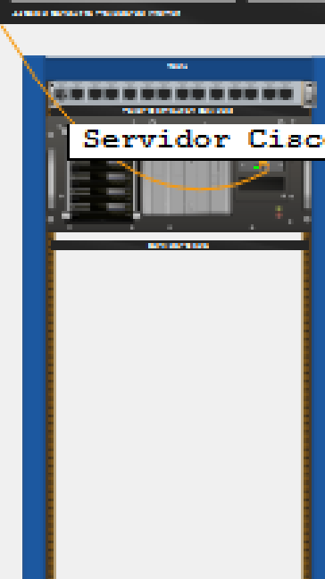

# NetAcad Study Archive

This folder contains the original Packet Tracer activities and reference files collected during the SENAC RJ Cisco Cybersecurity course.

## Inventory

The archive preserves 47 original study or reference files. The ZPF package adds five standard-named deliverables:

- 32 `.pka` guided activities.
- 3 `.pksz` packaged activities.
- 4 `.pkt` saved topologies.
- 1 `.zip` archive.
- 5 `.png` diagrams and Physical views.
- 1 `.htm` activity reference.
- 1 `.txt` configuration record.

The archive is about 347 MiB. The largest file is below the GitHub single-file limit. Filenames and formats remain unchanged.

## Visual files

## Suggested study order

1. Open a simple network activity.
2. Record the device names, interfaces, and address table.
3. Complete the guided configuration.
4. Check the result inside Packet Tracer.
5. Repeat the same idea in a saved `.pkt` file.
6. Compare the result with `PedroFerreira-configuracoes.txt` when the topic is routing, services, or wireless.

## Topics represented

- LAN construction and Packet Tracer navigation.
- IPv4 addressing, MAC identification, `ipconfig`, and ping.
- DHCP, DNS, Web, FTP, and NAT.
- Wireless router setup, client association, and wireless troubleshooting.
- ACLs, data integrity, threat scenarios, and physical IoT security.

## ZPF activity

The Configure a ZPF activity applies a zone based policy firewall on R3. It places G0/1 in IN-ZONE, S0/0/1 in OUT-ZONE, inspects traffic sourced from 192.168.3.0/24, and drops new traffic from the external side.

The result was verified live in Packet Tracer 9.0.1. Check Results reached 100%. PC-C reached PC-A, PC-A could not reach PC-C, and an SSH session from PC-C to R2 appeared as an inspected session on R3.

- [ZPF English guide](PedroFerreira_2026-10-23_Configurar-ZPF-README.md)
- [ZPF configured PKA](PedroFerreira_2026-10-23_Configurar-ZPF-concluido.pka)
- [ZPF verified PKA](PedroFerreira_2026-10-23_Configurar-ZPF-concluido.pkt.pka)
- [ZPF Portuguese report](PedroFerreira_2026-10-23_Configurar-ZPF-Relatorio.docx)

## Local source

`D:\VSCODE_PROJECTS\SENAC_CISCO_CIBERSECURITY\Packet Tracer\NetAcad`

## Git branch

The collection is published in [`projeto-netacad-estudos`](https://github.com/DATAdotPDF/SENAC-CISCO/tree/projeto-netacad-estudos). It is marked as study material and is separate from the delivery branches.

## Study boundary

Do not treat the activities as production configurations. Keep credentials private. Make a working copy before changing an original guided activity.
